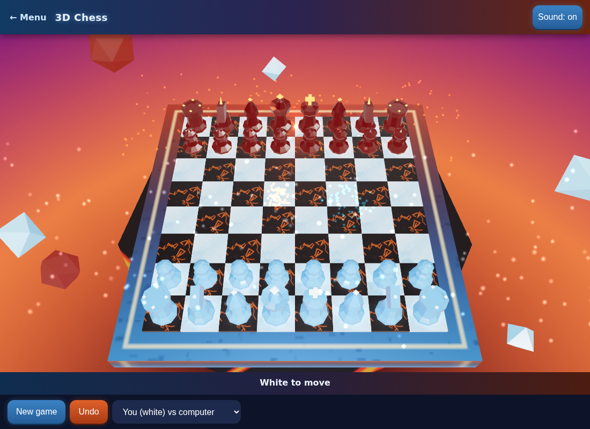
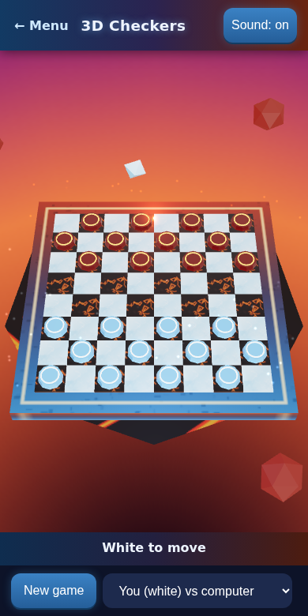

# Classic games in 3D

Browser games with a 3D board (three.js), a game menu, and PWA support (installable, works offline after the first visit).

- **Chess**: full rules through chess.js, play the computer (white) or two players on one device. The computer is a shallow search, so it is weak.
- **Checkers**: American rules (forced captures, multi-jumps, kings, promotion ends the move). Computer or two players. No draw rule yet.
- **Connect Four**: 7x6 board in 3D, computer (depth-5 search) or two players. Rules tested in node: horizontal, vertical, diagonal wins, full column, full board, the computer takes a win and blocks one.
- **One Minute Pop**: a small 2D tap game.

Drag to tilt the board, tap a piece and then a square to move.

## Run

Any static server works, for example `python3 -m http.server` in this folder, then open http://localhost:8000/. For GitHub Pages: Settings > Pages > deploy from branch `main`, folder `/ (root)`. All paths are relative.

## Tested

- chess.js perft: start position depth 3 = 8902, "Kiwipete" depth 2 = 2039.
- Checkers rules: forced capture, double jump, promotion ending a move, no backward capture for men, win on no moves, and 300 plies of computer self-play with every move legal (`js/checkers-rules.js`).
- Loaded in headless Chrome at 1100px and 390px wide: a move played by clicking on the board in chess and in checkers, the computer replied, the service worker registered, no console errors except one 404 for a favicon request.
- Not tested: a real phone, installing the PWA, offline mode after install, and the deployed GitHub Pages site.

 

## Licenses

three.js (MIT) in `lib/`, see `LICENSE-three.txt`. chess.js (BSD-2-Clause) in `lib/`, see `LICENSE-chess.js.txt`. The game code has no license set yet.
